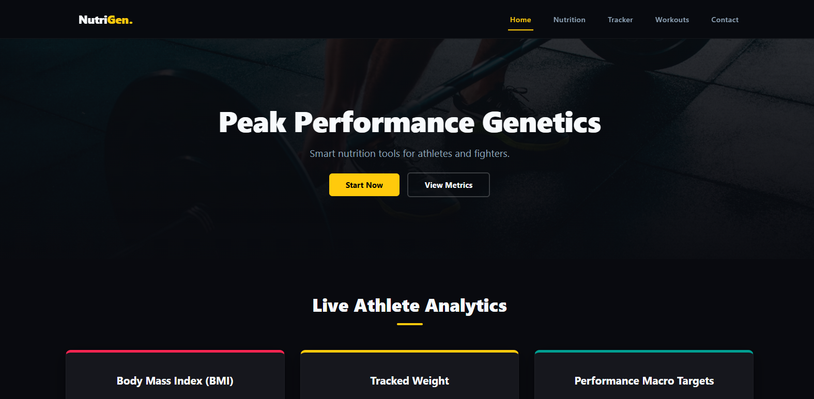
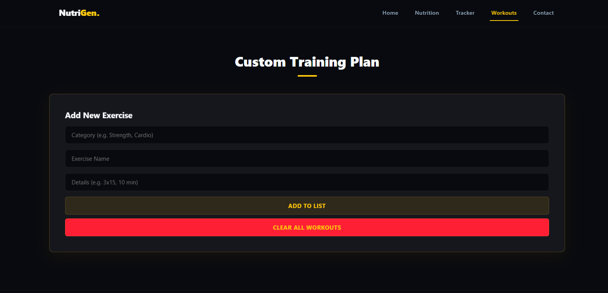
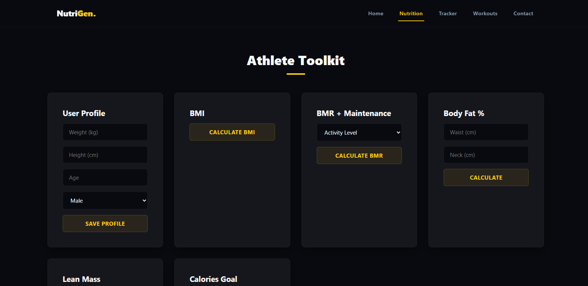

# 🥗 NutriGen – Smart Nutrition & Fitness Tracker

NutriGen is a web application designed to help users manage their nutrition, track their weight, and organize their fitness activities. It provides useful tools for monitoring health goals and maintaining a healthy lifestyle.

Developed as part of **CSCI426 – Web Advanced** at the **Lebanese International University (LIU)**.

---

## 🌐 Live Demo

- **Live Website:** https://nutrigen-cra.vercel.app/
- **GitHub Repository:** https://github.com/jadtaleb11/nutrigen-cra

---

## ✨ Features

- **User Login:** Login interface with a guest access option.
- **Dashboard:** Overview of fitness and nutrition information.
- **Nutrition Calculator:** Calculate BMI, BMR, body fat percentage, lean body mass, and daily calorie goals.
- **Weight Tracker:** Track weight progress and view recorded history.
- **Workout Tracking:** Explore workout information and fitness activities.
- **Contact Page:** Contact page for communication and inquiries.
- **Local Storage:** Save user information and tracking data locally in the browser.
- **Responsive Design:** Modern dark-themed interface with a yellow accent color.

---

## 🛠️ Technologies Used

- React.js
- Create React App (CRA)
- JavaScript (ES6+)
- HTML5
- CSS3
- React Router DOM
- Browser Local Storage

---

## 📁 Project Structure

```text
nutrigen-cra/
│
├── public/
│
├── src/
│   ├── assets/
│   │   ├── dashboard.png
│   │   ├── workouts.png
│   │   └── Nutrition.png
│   │
│   ├── components/
│   │   ├── Navbar.js
│   │   └── Footer.js
│   │
│   ├── pages/
│   │   ├── Login.js
│   │   ├── Login.css
│   │   ├── Home.js
│   │   ├── Nutrition.js
│   │   ├── Tracker.js
│   │   ├── Workouts.js
│   │   └── Contact.js
│   │
│   ├── App.js
│   ├── App.css
│   ├── index.js
│   └── index.css
│
├── package.json
├── package-lock.json
├── .gitignore
└── README.md
```

---

## 📸 Application Screenshots

### 🖥️ Main Dashboard View



### 🏋️ Workouts Tracking View



### 🥦 Nutrition Management View



---

## ⚙️ Installation & Setup

Follow these steps to run NutriGen locally.

### 1. Clone the Repository

```bash
git clone https://github.com/jadtaleb11/nutrigen-cra.git
```

### 2. Navigate to the Project Directory

```bash
cd nutrigen-cra
```

### 3. Install Dependencies

```bash
npm install
```

### 4. Start the Development Server

```bash
npm start
```

The application will run at:

```text
http://localhost:3000
```

---

## 🚀 Deployment

NutriGen is deployed using **Vercel**.

**Production Website:** https://nutrigen-cra.vercel.app/

The project is connected to GitHub for source code management and deployment updates.

---

## 🔄 Version Control

Git and GitHub are used for version control and project management.

- Source code hosted on GitHub.
- Project changes tracked through Git commits.
- Main development branch: `main`.

---

## 📚 Academic Information

| Detail | Information |
|---|---|
| Project Name | NutriGen |
| Course | CSCI426 – Web Advanced |
| University | Lebanese International University (LIU) |
| Project Phase | Phase 1 – Web 2 |
| Submission Date | November 12, 2026 |

---

## 👨‍💻 Developer

**GitHub:** [@jadtaleb11](https://github.com/jadtaleb11)

---

<p align="center">
  <strong>NutriGen – Eat Smart. Train Hard. Live Better.</strong>
</p>